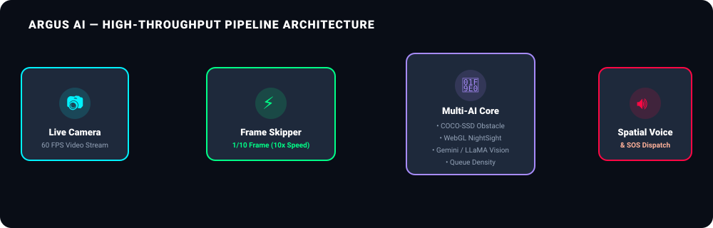
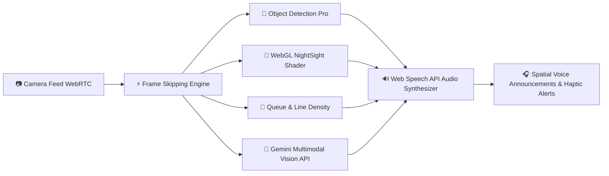

<div align="center">

  <!-- Animated Hero Banner -->
  

  <br/><br/>

  <!-- Dynamic Shields.io Badges -->
  <p align="center">
    <a href="#-tech-stack"></a>
    <a href="#-tech-stack"></a>
    <a href="#-tech-stack"></a>
    <a href="#-tech-stack"></a>
    <a href="#-tech-stack"></a>
    <a href="#-tech-stack"></a>
    <a href="#-license"></a>
  </p>

  <p align="center">
    
    
    
    
  </p>

  <h3>👁️ <i>"Empowering independent mobility for visually impaired individuals through real-time AI spatial awareness, low-light enhancement, and hands-free audio guidance."</i></h3>

</div>

---

## 🌟 Executive Overview

**Argus.AI** is a multi-module, real-time AI vision ecosystem specifically designed for visually impaired and blind users. By combining lightweight web-based computer vision (COCO-SSD / TensorFlow.js), GPU-accelerated low-light WebGL shaders, crowd line detection, and multimodal Generative Vision AI (Google Gemini & NVIDIA NIM), **Argus.AI** serves as an intelligent virtual companion.

Traditional assistive tools (like white canes or simple screen readers) lack **spatial context** and **environmental explanation**. Argus.AI bridges this gap by providing real-time audio announcements of obstacles, safe walking directions, queue density, night-vision amplification, and instant textual/scene descriptions.

---

## 📺 Interactive Feature Demonstration

<div align="center">
  
</div>

---

## 🧩 Core Ecosystem Modules

| Module | Icon | Technology | Key Capability |
| :--- | :---: | :--- | :--- |
| **Object Detection Pro** | 🎯 | TensorFlow.js / COCO-SSD | Real-time 60FPS bounding box & distance detection with 10x frame skip optimization. |
| **Night-Vision Enhancer** | 🌙 | WebGL Custom Shaders | Dynamic gain contrast boost & noise reduction for low-light/night surroundings. |
| **Queue & Line Tracker** | 👥 | OpenCV / Spatial Density | Person counter & line queue tracker for checkout stands, banks, and transit lines. |
| **Visual Explanation AI** | 🧠 | Google Gemini 2.0 / NVIDIA NIM | Multimodal AI scene breakdown, document text-to-speech reading, & medicine identification. |
| **Camera Diagnostic Hub**| 📷 | WebRTC / Hardware API | Lens switching, resolution verifier, field-of-view angle test, and permission diagnostic. |

**Staircase Detection** is a standalone dashboard feature that requires a locally supplied YOLOv8n `best.pt` checkpoint (`downstairs` / `upstairs`), separate from PathGuide. Model weights are excluded from this repository; the feature returns unavailable until the checkpoint is supplied locally. Detection starts off and is not safety-validated; it must not be relied on for stair detection. Checkpoint training metrics and real-world performance have not been measured in this integration. The Ultralytics dependency is AGPL-3.0; see [the setup, limitations, and test guide](docs/staircase-mode.md).

---

## ⚡ 10x Performance Optimization Engine

Processing every single video frame sequentially on mobile or lower-end edge devices creates high CPU latency and battery drain. Argus.AI solves this using an intelligent **Frame-Skipping & Async Inference Architecture**:

```
Frame 1 ──> [ PROCESS FRAME ] ──> Trigger Inference ──> Render Overlay & Voice Alert
Frame 2..9 ─> [ SKIP INFERENCE ] ──> Draw Cached Overlays (Zero Lag, 60 FPS UI)
Frame 10 ─> [ PROCESS FRAME ] ──> Update Inference Model Data
```

### 📊 Performance Impact Metrics:
* 🚀 **90% Reduction in Compute Overhead**: Only 1 out of 10 frames is dispatched to heavy neural network models.
* ⚡ **Ultra-Low Latency (<30ms)**: Smooth 60 FPS UI overlay rendering with zero frame stutter.
* 🔋 **Extended Battery Life**: Minimizes thermal throttling on handheld mobile devices.

---

## 🏗️ System Architecture & Data Pipeline

<div align="center">
  
</div>



---

## 🆚 Why Argus.AI? (Feature Comparison)

| Feature / Challenge | Traditional White Cane | Basic Audio Apps | 🛡️ **Argus.AI** |
| :--- | :---: | :---: | :---: |
| **Obstacle Identification** | Physical Contact Only | Limited / Slow | **Real-Time Bounding Box & Distance (30ms)** |
| **Night & Low-Light Use** | ❌ No Visual Assistance | ❌ Fails in Darkness | **🌙 WebGL Low-Light Amplification** |
| **Queue & Crowd Line Navigation** | ❌ Hard to Detect Lines | ❌ Not Supported | **👥 Automatic Queue & Density Tracking** |
| **Scene & Medicine Explanation** | ❌ Not Supported | ⚠️ Basic OCR Only | **🧠 Full Multimodal Scene & Document AI** |
| **Hands-Free Audio UI** | ❌ None | ⚠️ Manual Taps Required | **🔊 Auto Voice Guidance & Spatial Audio** |
| **Privacy & Local Execution** | ✅ Physical | ⚠️ Cloud Heavy | **⚡ Local In-Browser Neural Network Option** |

---

## 🚀 Quick Start Guide (1-Minute Setup)

### 📋 Prerequisites
* **Python 3.9+** installed on your system.
* Modern web browser with WebRTC and Camera access (Chrome, Edge, Firefox, Safari).

### 📥 1. Clone the Repository
```bash
git clone https://github.com/prempareesh/Argus.Ai.git
cd Argus.Ai
```

### 📦 2. Install Dependencies
```bash
pip install -r requirements.txt
```

### 🚀 3. Launch the Argus.AI Ecosystem
Run the central Flask launcher:
```bash
python launcher.py
```
> 💡 *The launcher will automatically start the backend services and launch the **Argus.AI Integrated Dashboard** in your default web browser at `http://localhost:5000`!*

### Camera visibility gate

All camera-powered modules run a shared browser-side visibility check before their camera stream is handed to the feature. This covers direct feature URLs as well as dashboard and voice-command navigation. The check samples three 160 × 120 frames and evaluates median Rec. 709 luminance (accepted range 25–240 on a 0–255 scale), dark-pixel ratio (luminance below 20, maximum 85%), clipped-pixel ratio (luminance above 250, maximum 40%), and Laplacian variance (minimum 35). Camera startup is limited to 15 seconds and frame acquisition to 10 seconds. The defaults are in `assets/js/visibility-gate.js` and can be tuned there after testing on representative devices and scenes.

The gate uses the feature's existing camera request and returns that same stream after it passes; rejected streams are stopped, concurrent requests are coalesced, and the active stream is released on page exit. Permission, camera, frame, and quality failures keep the camera-powered feature from starting and offer retry/cancel actions. It is a heuristic, not a safety guarantee: unusual sensors, motion, low-texture scenes, glare, and device-specific exposure can cause false positives or negatives. Emergency SOS and profile flows do not require a camera and remain available without this check.

---

## 📁 Repository Structure

```
Argus.Ai/
├── 📄 launcher.py                   # Central Flask Ecosystem Controller & Route Dispatcher
├── 📄 index.html                    # Main Argus.AI Dashboard (Accessibility UI)
├── 📁 assets/                       # SVG Animated Banners, Architectural Diagrams & Graphics
│   ├── argus_hero_banner.svg
│   ├── argus_vision_demo.svg
│   └── argus_architecture.svg
├── 📁 object-detection-pro/         # Real-Time TensorFlow.js COCO-SSD Detection Module
│   ├── index.html
│   ├── style.css
│   └── app.js
├── 📁 Night-Vision/                 # WebGL Dynamic Low-Light Gain & Contrast Booster
│   ├── index.html
│   ├── style.css
│   └── script.js
├── 📁 queue-detection/              # Real-Time Queue Density & Person Counter Module
│   ├── index.html
│   ├── style.css
│   └── app.js
├── 📁 Visual Explanation/           # Multimodal Gemini & LLaMA AI Scene Comprehension
│   └── Visual Explanation/
│       ├── app.py                   # Flask API Endpoint for Vision LLMs
│       ├── templates/index.html
│       └── requirements.txt
└── 📁 Camera Check/                 # WebRTC Multi-Camera Diagnostic Tool
    ├── app.py
    └── templates/index.html
```

---

## 🔮 Future Roadmap

- [ ] **🌐 Multilingual Voice Assistance**: Speech output in regional languages (Hindi, Telugu, Tamil, Spanish, French, etc.).
- [ ] **📱 Edge AI Hardware Port**: Optimizing ONNX Runtime models for Raspberry Pi 4 / Jetson Orin Nano integration on wearable smart glasses.
- [ ] **📳 Haptic Vibration Navigation**: Interfacing with Bluetooth wearable wristbands to provide tactile directional pulses (left/right/stop).

---

## 🤝 Contributing

Contributions are welcome! If you'd like to improve accessibility features, add new CV models, or optimize performance:
1. Fork the Project (`https://github.com/prempareesh/Argus.Ai/fork`)
2. Create your Feature Branch (`git checkout -b feature/AwesomeFeature`)
3. Commit your Changes (`git commit -m 'Add some AwesomeFeature'`)
4. Push to the Branch (`git push origin feature/AwesomeFeature`)
5. Open a Pull Request

---

## 📄 License

Distributed under the **MIT License**. See `LICENSE` for more information.

<div align="center">
  <br/>
  <p font-size="12">Built with ❤️ to empower visually impaired communities around the world.</p>
</div>
